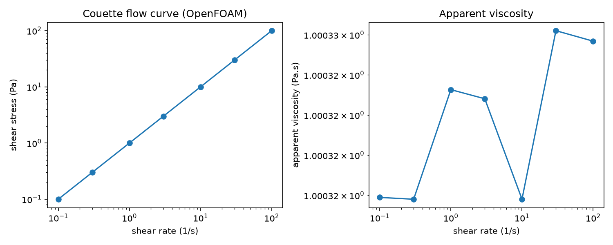

# openfoam-skill

Skill teaching an agent to run open-source OpenFOAM finite-volume
simulations from an English discussion — starting with a Couette
rheometer flow curve. **Public repo. No license needed.**

OpenFOAM (openfoam.com, ESI/OpenCFD) is the open-source standard
for finite-volume CFD, GPL, C++ with MPI. This is the open-source
counterpart of the private `mstar-skill` repo and of
`palabos-skill`: same workflow, same Couette example, different
solver — no license seat, no GUI, no `.msb` file. Instead you write
dictionary files and run the solvers from the command line. The
payoff over the LBM routes: built-in rheology models (Newtonian,
power-law, Herschel–Bulkley, Bird–Carreau, Cross, Casson),
a `rotatingWallVelocity` boundary condition, and a mature
steady/transient solver pair (`simpleFoam` / `pimpleFoam`).

## Quickstart

```bash
git clone https://github.com/marcocaggioni/openfoam-skill.git
cd openfoam-skill
uv sync              # Python side only (numpy, matplotlib, pyyaml)
bash scripts/install-openfoam.sh   # OpenFOAM v2412 via the official Debian repo
bash scripts/check-setup.sh
copilot
```

First prompt:

```
/openfoam-simulation run the Couette example in examples/couette/case.yaml
```

Or one go: `copilot -i "Use the /openfoam-simulation skill to run the Couette example in examples/couette/case.yaml"`. Copilot must be started from the repo root; if the skill was added mid-session, run `/skills reload`. See `QUICKSTART.md`.

## The workflow

1. **Discuss** in English — geometry, fluid + rheology, sweep, what is measured.
2. **Write `case.yaml`**, show it, get a yes. Never skip this, never invent a number.
3. **Mesh** — `blockMeshDict`: a 4° wedge sector for Couette, checked with `checkMesh`.
4. **Build** the case (copy template, substitute Omega). Dry-run by default.
5. **Sweep / run** — one `simpleFoam` run per shear rate, torque CSV per run.
6. **Post-process** torque → flow curve, with a mandatory Newtonian validation gate (analytic Couette torque, ~10%).
7. **Report** — plot + CSV + assumptions + validation + unverified items.

## The Couette example

Fluid in a Couette rheometer, inner cylinder rotating, outer fixed,
torque on the bob → flow curve. Defaults (labelled, to confirm):
R_i = 0.020 m, R_o = 0.025 m, L = 0.060 m, Newtonian η = 1.0 Pa·s,
ρ = 1000 kg/m³, γ̇ = 0.1 → 100 s⁻¹ log-spaced, 40 cells across the
5 mm gap. The mesh is a 4° wedge sector (axisymmetric: no Taylor
vortices, no end effects) with torque scaled ×5400 to the full
cylinder. Same numbers as the M-Star and Palabos examples, so the
solvers can be compared point for point.

## Results — it ran

<video src="https://raw.githubusercontent.com/marcocaggioni/openfoam-skill/main/examples/couette/couette-sweep.mp4" controls></video>

Steady state at each shear rate, γ̇ = 0.1 → 100 s⁻¹. The spin-up at γ̇ = 10 s⁻¹ is in [couette-gamma10.mp4](examples/couette/couette-gamma10.mp4).



Newtonian validation **PASSED**: max analytic-torque error **0.03%**, η_app = 1.0003 Pa·s (true 1.0) at all seven shear rates. Note the mesh is a 4° wedge sector, not a full 3D annulus — no end effects yet. Full numbers in [examples/couette/RUN_REPORT.md](examples/couette/RUN_REPORT.md).

## How this compares

Same Couette case, same validation, five solvers. Full write-up: [docs/comparison.md](docs/comparison.md).

| Solver | Method | Repo | Validation (max error) | η_app | Sweep video |
|---|---|---|---|---|---|
| M-Star | LBM, GPU, licensed | [mstar-skill](https://github.com/marcocaggioni/mstar-skill) (private) | not yet run | — | — |
| Palabos | LBM, C++/MPI, AGPLv3 | [palabos-skill](https://github.com/marcocaggioni/palabos-skill) | 1.43% | 1.0143 | [video](https://github.com/marcocaggioni/palabos-skill/blob/main/examples/couette/couette-sweep.mp4) |
| XLB | LBM, Python/JAX | [xlb-skill](https://github.com/marcocaggioni/xlb-skill) | 1.16% | 0.988–1.000 | [video](https://github.com/marcocaggioni/xlb-skill/blob/main/examples/couette/couette-sweep.mp4) |
| OpenFOAM | Finite-volume, GPL | [openfoam-skill](https://github.com/marcocaggioni/openfoam-skill) | 0.03% | 1.0003 | [video](https://github.com/marcocaggioni/openfoam-skill/blob/main/examples/couette/couette-sweep.mp4) |
| OpenLB | LBM, C++/CUDA, GPLv2 | [openlb-skill](https://github.com/marcocaggioni/openlb-skill) | 0.94% | 1.0093 | [video](https://github.com/marcocaggioni/openlb-skill/blob/main/examples/couette/couette-sweep.mp4) |

## Status — v0.1

- `couette_build.py`, `couette_sweep.py`, `couette_post.py`:
  **tested in this VM** (OpenFOAM v2412, Ubuntu 24.04, 2026-11-17).
- **Newtonian validation PASSED on a real run**: full sweep
  γ̇ = 0.1 → 100 s⁻¹, η_app = 1.0003 Pa·s at γ̇ = 10
  (true 1.0), analytic torque error 0.03% — see
  `examples/couette/RUN_REPORT.md`, `flow_curve.csv/png`, and the
  videos `couette-gamma10.mp4` / `couette-sweep.mp4`.
- The transient `pimpleFoam` spin-up also runs (1000 steps, ~2 s)
  and converges to the same torque.
- Still open: non-Newtonian fluids (no model run yet — the
  Herschel–Bulkley / Bird–Carreau coefficients are documented in
  `docs/openfoam-guide.md` but unverified) and a full 3D annulus
  (wedge sector here).

## Files

- `skills/openfoam-simulation/SKILL.md` — the skill, mirrored at `.github/skills/openfoam-simulation/SKILL.md`
- `docs/openfoam-guide.md` — install, mesh, BCs, non-Newtonian notes, limits
- `examples/couette/` — the worked example
- `scripts/check-setup.sh` — readiness check (copilot, uv, simpleFoam, blockMesh, checkMesh)

OpenFOAM: https://www.openfoam.com (GPL).
This repo's own code: MIT.
